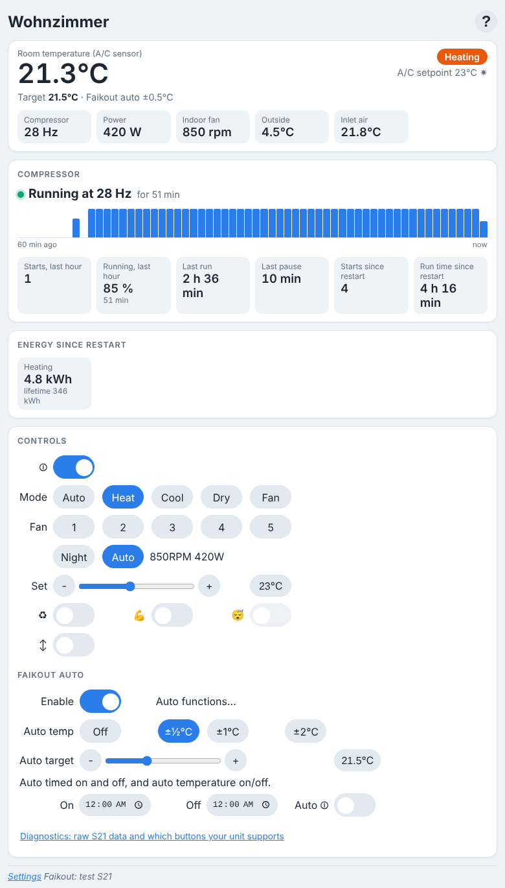
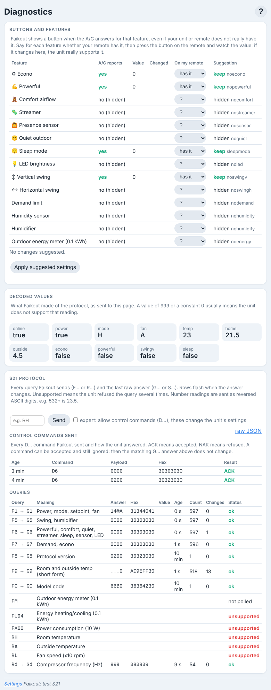
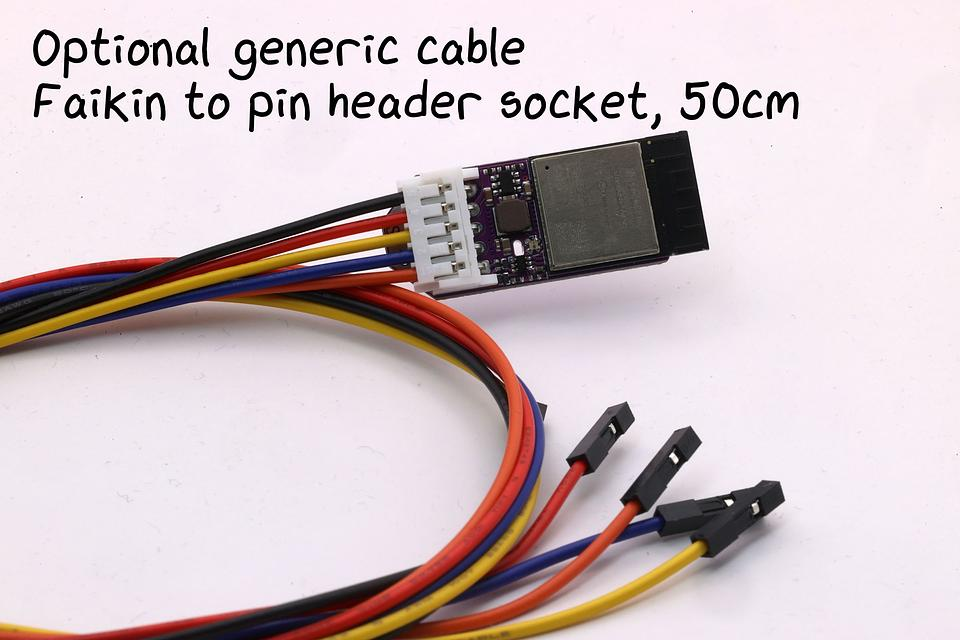

# About this fork

This is an **unofficial fork** of [RevK/ESP32-Faikout](https://codeberg.org/RevK/ESP32-Faikout) (Codeberg). It is not affiliated with or supported by Andrews & Arnold Ltd / RevK. *Faikout* is their registered trademark. Please do not report problems with this fork upstream. Everything below the line is the original upstream README.

The fork adds a status dashboard and a diagnostics page to the web interface, plus a few changes for an inverter that should run long and slow instead of cycling (developed on a Daikin ATXC35, S21 protocol).

## Branches

| Branch | Content |
|---|---|
| `dev` (default) | All changes of this fork, the one to build and flash |
| `main` | Exact mirror of the Codeberg `main`, overwritten every night by [sync.yml](.github/workflows/sync.yml) - never commit here |
| `feature/*` | Single topics (`webui-dashboard`, `defaults`, `diagnostics`), merged into `dev` |

To pick up upstream changes: `git switch dev && git rebase main` (or merge), then push.

## What is different

### Web UI: dashboard, explanations, new look



- **Dashboard** at the top of the control page: room temperature vs target (and the Faikout auto band), what the unit is doing (heating, cooling, idle, defrost...), tiles for compressor frequency, power, fan, outside, inlet, liquid pipe, humidity. Tiles only appear for values the unit reports.
- **Compressor card**: running/stopped and for how long, one bar per minute for the last hour (seconds running), starts and run share in the last hour, last run and pause, totals since restart. Long solid blocks = steady low-power operation, short blocks with gaps = cycling.
- **Energy since restart** from the unit's own counters (hidden if the unit has none).
- **? button**: short explanation under every control, including all Faikout auto settings. Remembered per browser.
- Cards instead of one long table, system font, **dark mode**, better on phones. The old "Temps" row moved into the dashboard.
- These statistics are kept in RAM since boot and only sent to the web page (`stats` object on the web socket). MQTT and Home Assistant are unchanged.

*(Screenshots rendered with sample data.)*

<br clear=right>

### Diagnostics page `/diag`



Linked at the bottom of the controls.

- **Buttons and features**: which features the unit really reports, live values, whether a value changed while the page was open (press the button on your remote to test), and whether your remote has it. Suggests the matching hide settings (`nosensor`, `noquiet`, ...) and can apply them (not when a settings password is set).
- **Decoded values** as sent by Faikout.
- **S21 protocol**: every query with its last raw answer (ASCII, hex, decoded number), age, count, changes, and whether the unit supports it. Rows flash on change.
- **Control commands sent** (`D...`) with the unit's answer, ACK or NAK.
- **Send** your own queries (`F...`, `R...`); with *expert* ticked also control commands (`D...`).
- Raw data at `/diag.json`.

<br clear=right>

### Behaviour and settings

| Change | Details |
|---|---|
| Tuned defaults | `heatback` 6 → 1, `heatover` 6 → 2, `autor` - → 0.5, `tempnoflap` 0 → 600 s, `autofmax` 5 → 3, `i2chtemp` 4.0 → 3.0. Aim: the inverter modulates down instead of switching off and on. Defaults only apply to settings you have never changed. |
| Compressor `999` | Some units answer the compressor query with `999` = no data. That value is now ignored: no `comp` on MQTT, the HA entity is removed, no compressor card. |
| `noenergy` | New setting: unit has no outdoor energy meter (`FM` always 0). Stops polling and reporting it, removes the HA entity. |
| `sleepmode` | New setting for the remote's Sleep (night) mode, read from `G6` byte 2 bit `0x02`: **Off** (not shown), **Status** (default, read-only switch in the web UI, reported on MQTT, binary sensor in Home Assistant) or **Switch** (control from web UI, MQTT command `sleep`, HA switch). The ATXC35 accepts the command but ignores it, hence Status. |
| Firmware upload | Enabled (`CONFIG_REVK_WEB_OTA`): *Settings → Firmware*. |

## Building and installing

Every push to a branch other than `main`/`sync` is built by [build.yml](.github/workflows/build.yml) (ESP-IDF v6.1, `make s3` = S3-MINI-N4-R2; add other variants such as `s3eth`, `c3` to the matrix). The binaries are attached to the workflow run:

```
gh run list -b dev
gh run download <run id> --dir fw
```

**Signing**: the firmware only accepts updates signed with the same key it was built with. Create your own key once and store it as repository secret `FAIKOUT_SIGNING_KEY`:

```
openssl genrsa -out faikout_signing_key.pem 3072
gh secret set FAIKOUT_SIGNING_KEY < faikout_signing_key.pem
```

Keep the key private and outside the repository. Without the secret every build uses a random key.

**First install** (the unit runs RevK's firmware, which only accepts RevK-signed updates): once over USB, keeping your settings:

```
esptool --chip esp32s3 read-flash 0 0x400000 backup.bin
esptool --chip esp32s3 -b 460800 write-flash --flash-mode dio --flash-freq 40m --flash-size keep \
  0x0 bootloader.bin 0x8000 partition-table.bin 0xd000 ota_data_initial.bin 0x10000 Faikout.bin
```

**Later updates**: *Settings → Firmware*, upload **`Faikout-S3-MINI-N4-R2.bin`** (the file name must contain the variant, `Faikout.bin` is refused). Switch off `otaauto`, RevK's updates do not match your key.

The CI patches one line of the ESP32-RevK library (missing `<sys/param.h>` for the firmware upload with ESP-IDF v6.1), see the *Patch library* step.

---

## Support

You can support this project in many ways, including testing and diagnostics, merge requests, clearly described issues and suggestions, and [buying Faikout boards from us](https://shop.revk.uk?mrlHiG1i). Thank you all for your support. This is open source so others can make and sell (with trademark restrictions). AI based bug reports or MRs will get you blocked.

<a href="https://shop.revk.uk?mrlHiG1i" alt="Buy it on Lectronz"></a>

# ESP32-Faikout

Everyone knows Daikin make some of the best air conditioners out there, mechanically speaking. Sadly their WiFi control modules are not so good, especially the latest models which are all cloud based, require an internet connection to even work, and are slow.

[](https://www.youtube.com/watch?v=7ANKUI45cHw "Faikout")



This code/module provides local control via web interface, MQTT, and HomeAssistant integration, all with no cloud crap.


* There is also a new [Faikout Remote Control](https://remote.revk.uk/) available, BLE linked to the Faikout, with environmental sensors, available now.

I'd like to thank the contributors, but contributions are made and accepted on basis that you issue your contribution under the same GPL licence as the project. Forks are allowed on the basis that your forks are on the same GPL licence as the project.

## Trademark

This is an open source project, but bear in mind you cannot sell boards bearing the Andrews & Arnold Ltd name, the A&A logo, the registered trademark Faikout, the registered trademark AJK logo, or the GS1 allocated EANs assigned to Andrews & Arnold Ltd.

Note the name change from Faikin to Faikout as Daikin complained to Amazon and caused a lot of issues. As such Faikout is now a registered trademark to avoid such issues.

## Further manuals / links

- [Work in progress / release notes](/RevK/ESP32-Faikout/wiki/Work-in-progress)
- [Wiring](/RevK/ESP32-Faikout/wiki/Wiring)
- [Setup](Manuals/Setup.md) Manual
- [Controls](Manuals/Controls.md) Manual
- [Advanced](Manuals/Advanced.md) Manual
- [ESP8266 port](https://github.com/Sonic-Amiga/ESP8266-Faikin) of this code
- [list of supported air-con](/RevK/ESP32-Faikout/wiki/List-of-confirmed-working-air-con-units) WiKi (please update as needed)
- [DoC](Manuals/DoC.md) and Vulnerability disclosure policy
- [S21](Manuals/S21.md) reverse engineered details of `S21` protocol

For support, see issues.

## Safety

Always propely isolate power before opening your air-con. Take care as dangerous voltages. Some connector types have dangerous voltage in operation.

### Ethernet

The Ethernet board has an RJ45 10/100 Ethernet connector for improved reliability and privacy. The Ethernet has an isolating transformer and clearances, but I have to stress **this is a prototype/dev board for specialist/hobbyist use only, and is NOT certified for grid power safety isolation. DO NOT USE WITH X403 CONNECTOR or any connector with dangerous voltages.**

### PoE Ethernet (design not finished)

The PoE Ethernet board has an RJ45 10/100 Ethernet connector for improved reliability and privacy, with PoE power for the Faikout module. The PoE power module has electrical isolation. The board also has opto isolators for the S21 connection, electrically isolating it from the air conditioning unit. This adds extra layers of safety, however I have to stress **this is a prototype/dev board for specialist/hobbyist use only, and is NOT certified for grid power safety isolation.**

Design now works, and boards on order.

## PCB and case

Buy from [shop.revk.uk](https://shop.revk.uk?mrlHiG1i). Also available from a third party in Australia eBay.


New Ethernet option.


New Opto-isiolated PoE Ethernet option.


Board are supplied in a panel, with snap off parts. The basic Faikout board can be two sizes 45x36mm or 40x16mm.


## Why I made this

The history is that, after years of using Daikin air-con in my old home, and using the local http control, in my new house in Wales the WiFi was all cloud based with no local control, and useless, and slow. Just configuring it was a nightmare. I spent all day reverse engineering it and making a new module to provide local control. Pull requests and feature ideas welcome.

This whole project is almost entirely by me, but with some valuable contributions from others (thank you). All of my bits are copyright by me and Andrews & Arnold Ltd who sponsor the whole project, and released under GPL. Whilst not required by the licence, attribution and links would be appreciated if you reuse this.

## How to get one

But also, the PCB designs are published, including production files for [JLCPCB](https://jlcpcb.com). You need to remove trademarks, etc, and you would also need something to program them (TC2030 lead). Obviously you need some experience with PCB ordering and diagnostics if getting your own boards made.

# Set-up

Appears as access point with simple web page to set up on local WiFI. On iPhone the setup page auto-loads.


# Operation

Local interactive web control page using *hostname*.local, no app required, no external internet required.


- [Setup](Manuals/Setup.md) Manual
- [Controls](Manuals/Controls.md) Manual
- [Advanced](Manuals/Advanced.md) Manual

# Design

* KiCad PCB designs included, with JLCPCB production files
* 3D printed case STL files
* Documentation of reverse engineered protocol included

Basically, Daikin have gone all cloudy with the latest WiFi controllers. This module is designed to provide an alternative.


* Simple local web based control with live websocket status, easy to save as desktop icon on a mobile phone
* MQTT reporting and controls
* Works with Home Assistant over MQTT - note Home Assistant can work with HomeKit
* Includes linux mysql/mariadb based logging and graphing tools
* Works with [EnvMon](https://codeberg.org/RevK/ESP32-EnvMon) Environmental Monitor for finer control and status display
* or, works with BlueCoinT and Telink [BLE temperature sensor](Manuals/BLE.md) as a remote reference in an auto mode
* Automatically works out if S21 or X50 protocol (used on bigger/ducted units)
* Backwards compatible direct `/aircon/...` URLs

# Building code yourself

Git clone this `--recursive` to get all the submodules, and it should build with just `make`. There are make targets for other variations, but this hardware is the `make pico` or `make s3` version. The `make` actually runs the normal `idf.py` to build which then uses cmake. `make menuconfig` can be used to fine tune the settings, but the defaults should be mostly sane. `make flash` should work to program. If flashing yourself, you will need a programming lead, e.g. [Tazmotizer](https://codeberg.org/RevK/Tasmotizer-PCB) or similar, and of course the full ESP IDF environment. The latest boards also have 4 pads for direct USB connection to flash with no adaptor. The modules on Amazon come pre-loaded and can upgrade over the air.

The code is normally set up to automatically upgrade the software, checking roughly once a week. You can change this in settings via MQTT.

If you build yourself, you either need no code signing, or your own signing key. This will break auto-updates which try to load my code releases, so you need to adjuist settings `otahost` and `otaauto` accordingly. You can set these in the build config, along with WiFi settings, etc.

## Flashing code

You will need to connect a suitable programming lead. Boards have a tag-connect compatible header for a [TC2030-USB-NL](https://www.tag-connect.com/product/tc2030-usb-nl) lead. Note that the latest boards have test pads on the back which include USB, so you can solder a USB lead if necessary.

See [https://codeberg.org/RevK/ESP32-RevK](https://codeberg.org/RevK/ESP32-RevK) for more details of how to flash the files easily.
